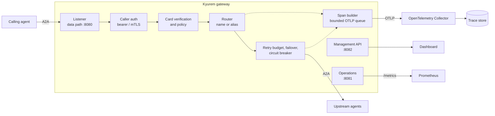

<p align="center">
  
</p>

<h1 align="center">Kyurem</h1>

<p align="center">
  <b>An A2A gateway for routing, tracing, policy, and resilient agent calls.</b><br>
  <i>Moves the protocol out of every agent's code path and parks it at the wire's edge.</i>
</p>

<p align="center">
  <a href="https://github.com/mevarx/Kyurem/actions/workflows/ci.yml"></a>
  <a href="https://github.com/mevarx/Kyurem/actions/workflows/a2a-conformance.yml"></a>
  <a href="https://github.com/mevarx/Kyurem/actions/workflows/python-demo.yml"></a>
  <a href="LICENSE"></a>
</p>

## Overview

Kyurem is a Go gateway that transparently proxies [A2A](https://a2a-protocol.org) v1.0 agents. It traces every handoff, accounts for reported token usage, enforces configurable trust and access rules, and handles upstream failures, so none of that has to live inside individual agents. A management API and React dashboard make multi-agent tasks diagnosable.

Agents point at the gateway; agent code does not change.


## Architecture



The gateway is stateless and streams request and response bodies. Telemetry export is asynchronous and bounded: under load, spans are dropped before traffic is delayed.

## Features

| Area | Capability |
|---|---|
| **Proxy** | Route by agent name or alias; JSON-RPC and HTTP+JSON; SSE streaming; agent card rewrite and cache; W3C trace context; graceful drain. |
| **Tracing** | One OpenTelemetry span per handoff, linked into task traces; bounded OTLP export. Cost is reported only when token usage is known. |
| **Dashboard** | Tasks, agent graph, costs, policy decisions and span events on a separately bound management API. |
| **Trust and policy** | Bearer or mTLS callers; agent card signatures verified against operator-configured keys; deny-overrides rules; bounded audit records. |
| **Resilience** | Bounded retry budget, same-binding failover and per-upstream circuit breakers. |

## Quick start

**Requirements:** Go 1.26+. The Python agents and failover walkthrough also need Python 3.11+ with [`uv`](https://docs.astral.sh/uv/) and Node 22. Docker is required only for the telemetry stack.

```sh
make build build-demo
make run-demo            # proxy walkthrough with Go demo agents
```

Failover walkthrough with the Python agents and dashboard:

```sh
make python-install dashboard-install
make demo-m6             # keeps services running; Ctrl+C to stop
make demo-m6-check       # same backend assertions, automatic cleanup
```

Other walkthroughs: `make demo-m2` (tracing, requires Docker) and `make demo-m3` (failure diagnosis through the management API).

With the Compose stack, the dashboard is at <http://localhost:3001> (demo token `kyurem-demo`, set on the Settings page) and Prometheus at <http://localhost:9090>, where the `kyurem_telemetry_*` series report spans ended, exported and dropped, queue depth and export retries.

## Configuration

| Listener | Default | Purpose |
|---|---|---|
| A2A data path | `127.0.0.1:8080` | Proxied traffic; cards at `/a2a/<agent>/.well-known/agent-card.json` |
| Operations | `127.0.0.1:8081` | Health, readiness, metrics, version |
| Management API | `127.0.0.1:8082` | Bearer-authenticated API used by the dashboard |

Configuration is strict YAML: unknown keys are rejected and the file is validated at startup. Scalar values can be overridden with `KYUREM_*` environment variables. The binary provides `serve`, `validate` and `version`.

```sh
go run ./gateway/cmd/kyurem validate --config config/kyurem.example.yaml
```

References: [`config/kyurem.example.yaml`](config/kyurem.example.yaml), [`config/kyurem.compose.yaml`](config/kyurem.compose.yaml), [`docs/configuration.md`](docs/configuration.md), [`api/openapi.yaml`](api/openapi.yaml).

## Behavior notes

**Trust and policy.** Signer-provided key URLs are never fetched. Skill filters are warn-only: A2A requests carry no authoritative skill selection, so enforce-mode skill rules are rejected at validation.

**Failure handling.** Defaults: two total attempts per call and ten additional attempts per agent per minute. A breaker opens after five consecutive upstream network or 5xx failures, stays open for 30 seconds, then allows one probe. Only 502, 503 and 504 are retried. Retryable requests are body-less GET, HEAD and OPTIONS, and POSTs with an `Idempotency-Key` whose body fits within `max_retry_body_bytes`; the upstream must deduplicate the key. SSE responses and other non-replayable calls are never replayed. Retry and failover steps appear as events on the handoff trace.

**Cost accounting.** Unknown token usage and cost stay unknown in the API and dashboard; they are never treated as zero.

## Conformance

The [A2A Conformance workflow](.github/workflows/a2a-conformance.yml) pins the official [`a2a-tck`](https://github.com/a2aproject/a2a-tck) and [`a2a-itk`](https://github.com/a2aproject/a2a-itk) repositories by commit. It runs the TCK MUST-level JSON-RPC suite against Kyurem with the Python demo upstream, then the ITK ACTS smoke profile for the demo's declared task and discovery behaviors. Full ACTS coverage spans capabilities the demo agent does not claim, so the CI profile is intentionally scoped. Reports are kept as workflow artifacts.

## Benchmarks

Measured on Linux x86_64 in a Modal sandbox (2 vCPU, 8 GiB RAM, Go 1.26.0). Load generation and the Go echo agent shared the host. These are measurements of the checked-in harness, not an SLA.

| Configured streams | Completed / failed | p50 / p95 / p99 (ms) | Peak active | Gateway RSS, before → after (Δ MiB) | Req/s |
|---:|---:|---:|---:|---:|---:|
| 1,000 | 5,015 / 0 | 3,109 / 7,159 / 9,039 | 235 | 54.0 → 231.2 (+177.2) | 245.0 |
| 5,000 | 5,697 / 0 | 13,289 / 24,702 / 26,048 | 282 | 231.2 → 1,022.9 (+791.7) | 184.6 |
| 10,000 | 847 / 10,555 | 19,997 / 28,822 / 29,287 | 22 | 1,022.9 → 1,342.4 (+319.6) | 25.6 |

The 10,000-stream tier did **not** sustain its target on this host; its latency covers completed requests during an overloaded run. Reproduce with `bash demo/scenarios/bench-load.sh` (raw output goes to `demo/bin/bench-results/`). Methodology: [`docs/benchmarks.md`](docs/benchmarks.md).

## Releases

Pushing a version tag such as `v0.1.0` triggers the release workflow, which builds binaries for Linux, macOS and Windows (amd64 and arm64 where supported) and publishes multi-architecture (linux/amd64, linux/arm64) images to GHCR:

`ghcr.io/mevarx/kyurem-gateway` · `kyurem-dashboard` · `kyurem-demo` · `kyurem-python-demo`

## Security

The sample configuration is for local development: caller authentication, card trust verification and policy enforcement are off, and demo credentials are for demonstrations only. Before exposing a deployment, configure credentials, trusted card-signing keys and policy modes, keep the management API on a private network, and treat captured trace data as sensitive.

## Development

```sh
make test             # gateway tests with the race detector
make test-demo        # Go demo tests
make test-python      # Python demo tests
make vet validate     # static checks and shipped configs
make dashboard-check  # typecheck, lint, tests
make dashboard-build
```

CI runs gateway build, vet, format and race tests, config and Compose validation, dashboard checks, Python demo tests and the A2A conformance job.

```
.github/workflows/   CI and release
api/                 OpenAPI contract
config/              Example and Compose configuration
dashboard/           React + TypeScript UI
demo/                Go and Python demo agents, scripted scenarios
deploy/              Dockerfiles and Compose stack
docs/                Milestones, configuration, benchmarks, telemetry conventions
gateway/             Go gateway (cmd/kyurem and internal packages)
```

## Status and limitations

Milestones M1 to M7 are delivered; see [`docs/milestones.md`](docs/milestones.md). Open items: sustaining the 10,000-stream benchmark tier, broader ACTS coverage beyond the smoke profile, dashboard policy editing (policy currently lives in configuration files), and the first tagged release.

More documentation: [`docs/telemetry-conventions.md`](docs/telemetry-conventions.md).

## Contributing

Issues and pull requests are welcome. Please include tests and run `make test vet validate` (plus `make dashboard-check` or `make test-python` when relevant) before opening a pull request. Report security issues privately to the maintainer ([@mevarx](https://github.com/mevarx)) rather than in a public issue.

## License

[Apache License 2.0](LICENSE)
