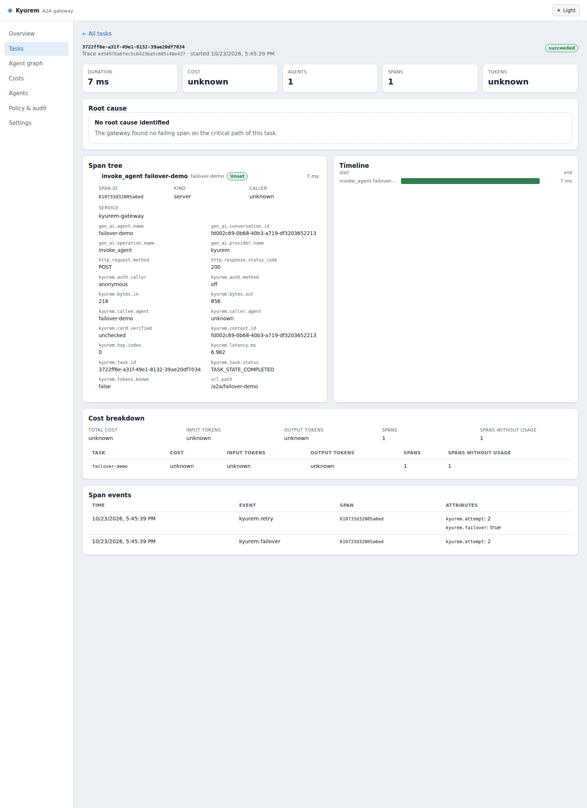
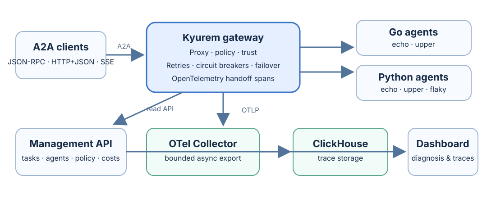

<div align="center">

# Kyurem

**An A2A gateway for routing, tracing, policy, and resilient agent calls.**

*Kyurem moves the protocol out of every agent's code path and parks it at the wire's edge.*

[](https://github.com/mevarx/Kyurem/actions/workflows/ci.yml)
[](https://github.com/mevarx/Kyurem/actions/workflows/a2a-conformance.yml)
[](https://github.com/mevarx/Kyurem/actions/workflows/python-demo.yml)
[](LICENSE)

</div>

Kyurem transparently proxies [A2A](https://a2a-protocol.org) v1.0 agents and gives you a management API and dashboard for diagnosing what a team of agents actually did: who called whom, what each hop cost, where a task failed, and whether the call was allowed.

It routes agent traffic without owning agent state. You point your agents at the gateway; agent code does not change.



*The task detail view shows the retry and failover events from the scripted M6 walkthrough.*

## Table of contents

- [Why Kyurem](#why-kyurem)
- [Architecture](#architecture)
- [Capabilities](#capabilities)
- [Quick start](#quick-start)
- [Interfaces and configuration](#interfaces-and-configuration)
- [Tracing and cost accounting](#tracing-and-cost-accounting)
- [Trust and policy](#trust-and-policy)
- [Failure handling](#failure-handling)
- [A2A conformance in CI](#a2a-conformance-in-ci)
- [Benchmarks](#benchmarks)
- [Releases](#releases)
- [Security notes](#security-notes)
- [Repository layout](#repository-layout)
- [Development checks](#development-checks)
- [Status and roadmap](#status-and-roadmap)
- [Documentation](#documentation)
- [Contributing](#contributing)
- [License](#license)

## Why Kyurem

A2A lets agents built with different frameworks talk to each other. It does not tell you what happened when a team of agents fails: which agent made the bad call, where a wrong answer was passed along, what each hop cost, or whether the caller should have been allowed to make the request.

Kyurem sits at the edge of those calls and handles that once, for every agent, instead of inside each agent's code.

## Architecture



Design principles:

- **Stateless gateway.** Configuration loads from files, so replicas can run behind a load balancer.
- **Stream, do not buffer.** Bodies are forwarded as streams; only the metadata needed for tracing is extracted.
- **Never block on telemetry.** Export is asynchronous and bounded. Under overload, telemetry is dropped before traffic is delayed.
- **Standards first.** A2A v1.0 on the data path; OpenTelemetry and OTLP for telemetry.
- **Fail safe.** Unsafe retries are refused and security modes are explicit.

## Capabilities

- **A2A proxy:** route by agent name or alias, forward JSON-RPC and HTTP+JSON, stream SSE, rewrite and cache agent cards, propagate W3C trace context, and drain on shutdown.
- **Tracing and accounting:** create a span per handoff, link task traces, export asynchronously through bounded OTLP queues, and report cost only when token usage is known.
- **Management and dashboard:** a separately bound API and views for tasks, agent graphs, costs, policy decisions and span events.
- **Trust and policy:** authenticate bearer or mTLS callers, verify cards against operator-configured keys, apply deny-overrides rules, and retain bounded audit records. Skill filters are warn-only because A2A has no authoritative selected-skill field.
- **Failure handling:** retry within a bounded budget, fail over between same-binding upstreams, and isolate unhealthy upstreams with circuit breakers. Retries require safe methods or an idempotency-keyed, bounded POST; the upstream must deduplicate the key.
- **Python demonstrations:** SDK-based echo and upper agents plus a deterministic fail-once agent show the retry path without side effects.

## Quick start

**Requirements:** Go 1.26+. For the Python agents and the dashboard failover walkthrough you also need Python 3.11+ with [`uv`](https://docs.astral.sh/uv/), and Node 22 for the UI. Docker is needed only for the telemetry stack and the Compose walkthroughs.

Build the gateway and the Go demo agents, then run the scripted proxy walkthrough:

```sh
make build build-demo
make run-demo
```

Run the failover walkthrough with the Python agents and the dashboard:

```sh
make python-install
make dashboard-install
make demo-m6
```

The walkthrough launches the Python flaky and healthy agents, Kyurem and the dashboard, posts one keyed task, and prints its task-detail URL. It keeps the services running until Ctrl+C. Use `make demo-m6-check` for the same backend assertions with automatic cleanup.

Other walkthroughs:

```sh
make demo-m2   # tracing (requires Docker)
make demo-m3   # failure diagnosis through the management API
```

### With the Compose stack

| Service | URL | Notes |
|---|---|---|
| Dashboard | http://localhost:3001 | Served by nginx, which proxies `/api` to the gateway. The demo token is `kyurem-demo`; set it on the dashboard's **Settings** page. |
| Prometheus | http://localhost:9090 | Look for the `kyurem_telemetry_*` series: spans ended, exported and dropped, queue depth and export retries. |

The demo token is for local demonstrations only. Running the full telemetry and ClickHouse stack locally requires Docker.

## Interfaces and configuration

| Listener | Default address | Purpose |
|---|---|---|
| A2A data path | `127.0.0.1:8080` | Proxied agent traffic. Agent cards are served under `/a2a/<agent>/.well-known/agent-card.json`. |
| Operations | `127.0.0.1:8081` | Health, readiness, metrics and version. |
| Management API | `127.0.0.1:8082` | Authenticated API used by the dashboard (bearer authentication). |

- The dashboard lives in `dashboard/`. In development, its proxy to the management API is configurable with `KYUREM_API_ORIGIN`.
- The binary has three subcommands: `serve`, `validate` and `version`.
- Configuration is strict YAML. Unknown keys are rejected and the file is validated at startup. Scalar values can be overridden with `KYUREM_*` environment variables.
- Files: [`config/kyurem.example.yaml`](config/kyurem.example.yaml), [`config/kyurem.compose.yaml`](config/kyurem.compose.yaml), reference in [`docs/configuration.md`](docs/configuration.md), and the management API contract in [`api/openapi.yaml`](api/openapi.yaml).

Check a config without starting the server:

```sh
go run ./gateway/cmd/kyurem validate --config config/kyurem.example.yaml
```

## Tracing and cost accounting

- Each handoff becomes an OpenTelemetry span, and hops that belong to one task are linked into a single trace tree.
- W3C trace context is propagated so traces continue across agents.
- Export uses OTLP through bounded queues. If the collector is unavailable, spans are dropped and counted instead of slowing agent calls.
- Cost is reported **only when token usage is known**. Unknown usage and cost stay unknown in the API and dashboard; they are never treated as zero.

See [`docs/telemetry-conventions.md`](docs/telemetry-conventions.md) for the span and attribute conventions.

## Trust and policy

- **Caller identity:** bearer tokens and optional mTLS.
- **Agent cards:** signatures are verified against operator-configured keys. Key URLs supplied by a card's signer are never fetched.
- **Policy:** deny-overrides rules decide which caller may reach which agent.
- **Audit:** bounded audit records, decision APIs and dashboard views.
- **Skill filters are warn-only.** A2A requests carry no authoritative skill selection, so enforce-mode skill rules are rejected at configuration validation.

All of this is off in the sample configuration until you turn it on.

## Failure handling

- **Failover:** configure ordered upstreams with the same binding to enable failover for that binding.
- **Retry budget:** by default at most two total attempts per call, and ten additional attempts per agent per minute.
- **Circuit breaker:** opens after five consecutive upstream network or 5xx failures, stays open for 30 seconds, then permits a single probe.
- **What is retried:** only transient HTTP 502, 503 and 504 responses. Other 5xx responses still count toward breaker state.
- **Retryable requests:** GET, HEAD and OPTIONS without bodies, and POST requests that carry an `Idempotency-Key` and whose body fits within `max_retry_body_bytes`.
- **Idempotency is a contract.** The key does not prove idempotency; the upstream must deduplicate repeated requests.
- **Never replayed:** SSE response bodies after headers are sent, streaming calls and other non-replayable requests.
- Retry and failover steps appear as events on the handoff trace.

## A2A conformance in CI

The [A2A Conformance workflow](.github/workflows/a2a-conformance.yml) pins the official [`a2a-tck`](https://github.com/a2aproject/a2a-tck) and [`a2a-itk`](https://github.com/a2aproject/a2a-itk) repositories by commit. It runs the TCK MUST-level JSON-RPC suite against Kyurem with the Python demo upstream, then runs the ITK ACTS smoke profile for the Python demo's declared task and discovery behaviors.

Full ACTS coverage spans capabilities the small demo agent does not claim, so the CI profile is intentionally scoped. Reports are retained as workflow artifacts.

## Benchmarks

Real-process streaming runs were collected on **Linux x86_64 in a Modal sandbox configured for 2 vCPU and 8 GiB RAM**, with **Go 1.26.0**. The virtual CPU model was not exposed. Gateway RSS is the process resident set size before and after each measurement interval; load generation and the Go echo agent ran on the same host. These are measurements of the checked-in harness, not an SLA.

| Configured streams | Completed / failed | p50 / p95 / p99 latency (ms) | Peak active streams | Gateway RSS before → after (Δ MiB) | Throughput (req/s) |
|---:|---:|---:|---:|---:|---:|
| 1,000 | 5,015 / 0 | 3,109 / 7,159 / 9,039 | 235 | 54.0 → 231.2 (+177.2) | 245.0 |
| 5,000 | 5,697 / 0 | 13,289 / 24,702 / 26,048 | 282 | 231.2 → 1,022.9 (+791.7) | 184.6 |
| 10,000 | 847 / 10,555 | 19,997 / 28,822 / 29,287 | 22 | 1,022.9 → 1,342.4 (+319.6) | 25.6 |

The 10,000-stream tier did **not** sustain its target on this 2-vCPU host. Its latency summarizes completed requests during an overloaded run and is not a successful 10k-capacity result.

The harness saves raw JSON and logs under `demo/bin/bench-results/` (git-ignored). Run it with:

```sh
bash demo/scenarios/bench-load.sh
```

See [`docs/benchmarks.md`](docs/benchmarks.md) for the in-process smoke tier and measurement details.

## Releases

The tag-triggered release workflow builds Kyurem binaries for Linux, macOS and Windows (amd64 and arm64 where supported), and publishes multi-architecture images (linux/amd64 and linux/arm64) to GitHub Container Registry:

| Image | Contents |
|---|---|
| `ghcr.io/mevarx/kyurem-gateway` | The gateway |
| `ghcr.io/mevarx/kyurem-dashboard` | The dashboard |
| `ghcr.io/mevarx/kyurem-demo` | Go demo agents |
| `ghcr.io/mevarx/kyurem-python-demo` | Python demo agents |

Pushing a version tag such as `v0.1.0` starts a release build.

## Security notes

The sample configuration prioritizes a quick local start:

- caller authentication, card trust verification and policy enforcement are **off** by default
- demo credentials such as the dashboard demo token are for demonstrations only

Before exposing a deployment:

1. Do not use demo credentials.
2. Enable caller authentication and set the trust and policy modes you need.
3. Configure trusted card-signing keys.
4. Keep the management API on a private network.
5. Treat captured trace data as sensitive.

## Repository layout

```
Kyurem/
├── .github/workflows/   CI: gateway, A2A conformance, Python demos, release
├── api/                 Management API contract (OpenAPI)
├── config/              Example and Compose configuration
├── dashboard/           React + TypeScript dashboard
├── demo/                Go and Python demo agents and scripted scenarios
├── deploy/              Dockerfiles and the local Compose stack
├── docs/                Milestones, configuration, benchmarks, telemetry conventions, images
├── gateway/             The Go gateway (cmd/kyurem and internal packages)
├── Makefile             Build, test and demo targets
├── go.work              Go workspace
└── LICENSE              Apache-2.0
```

## Development checks

```sh
make test             # Gateway Go tests with the race detector
make test-demo        # Go demo tests
make test-python      # Python demo agent tests
make vet
make validate         # shipped YAML configs
make dashboard-check  # typecheck, lint and tests
make dashboard-build
make demo-m3          # failure diagnosis via the management API
```

GitHub Actions runs the gateway build, vet, format and race-enabled tests, config and Compose validation, the dashboard checks, the Python demo tests, and the A2A conformance job. Compose syntax is validated in CI; running the full stack locally requires Docker.

## Status and roadmap

Milestones M1 to M7 are delivered: transparent proxy, tracing, dashboard, hardening and benchmarks, trust and policy, failure handling, and the documentation and deployment handoff. Details are in [`docs/milestones.md`](docs/milestones.md).

Known limits and possible next steps:

- [ ] Sustain the 10,000-stream benchmark tier, on larger hardware or after tuning
- [ ] Broaden A2A ACTS coverage beyond the smoke profile as demo agents claim more capabilities
- [ ] Publish the first tagged release (`v0.1.0`)
- [ ] Add policy editing to the dashboard (policy is currently changed in configuration files)

## Documentation

- [`docs/milestones.md`](docs/milestones.md): what each milestone delivered
- [`docs/configuration.md`](docs/configuration.md): configuration reference
- [`docs/benchmarks.md`](docs/benchmarks.md): benchmark methodology and results
- [`docs/telemetry-conventions.md`](docs/telemetry-conventions.md): span and attribute conventions
- [`api/openapi.yaml`](api/openapi.yaml): management API contract

## Contributing

Issues and pull requests are welcome.

1. Fork the repository and create a branch.
2. Make your change with tests.
3. Run `make test`, `make vet` and `make validate`, plus `make dashboard-check` if you touched the dashboard and `make test-python` if you touched the Python demos.
4. Open a pull request describing the change and why.

For security issues, please do not open a public issue. Contact the maintainer privately instead.

## License

Licensed under the [Apache License 2.0](LICENSE).
